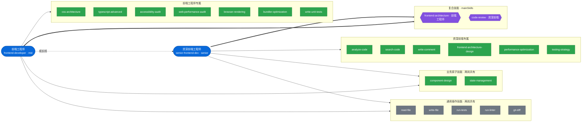
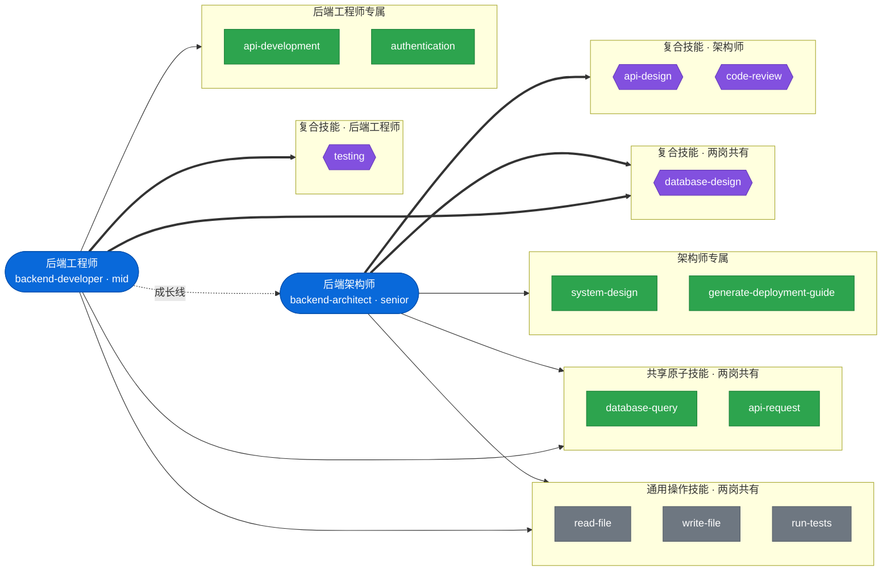
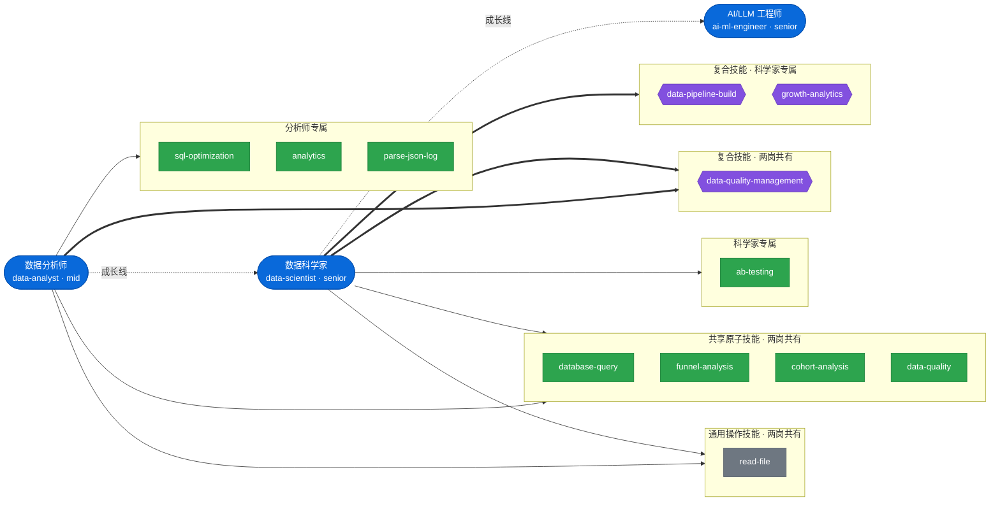
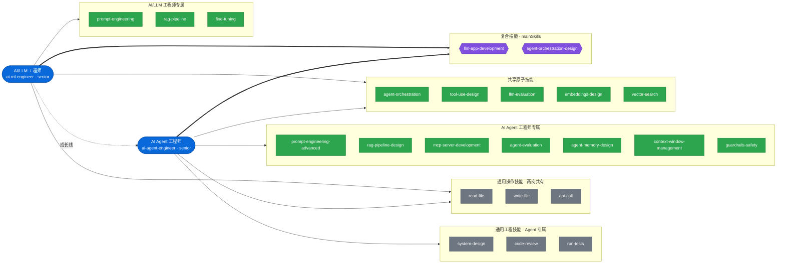
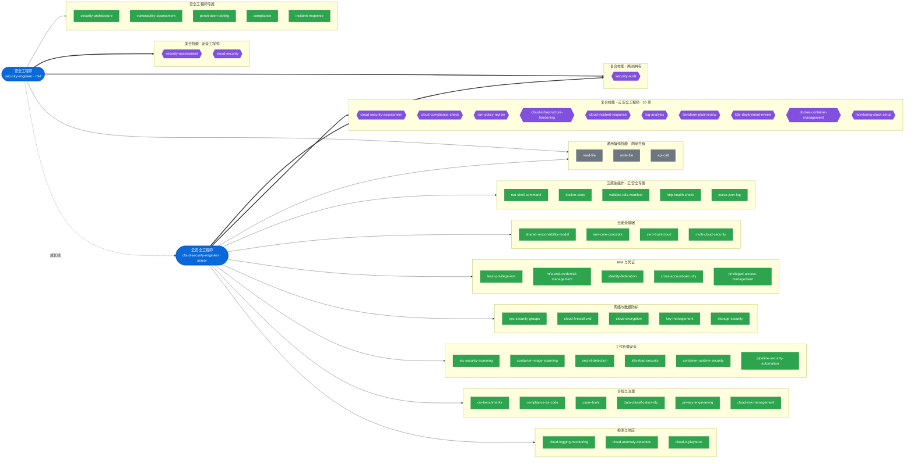
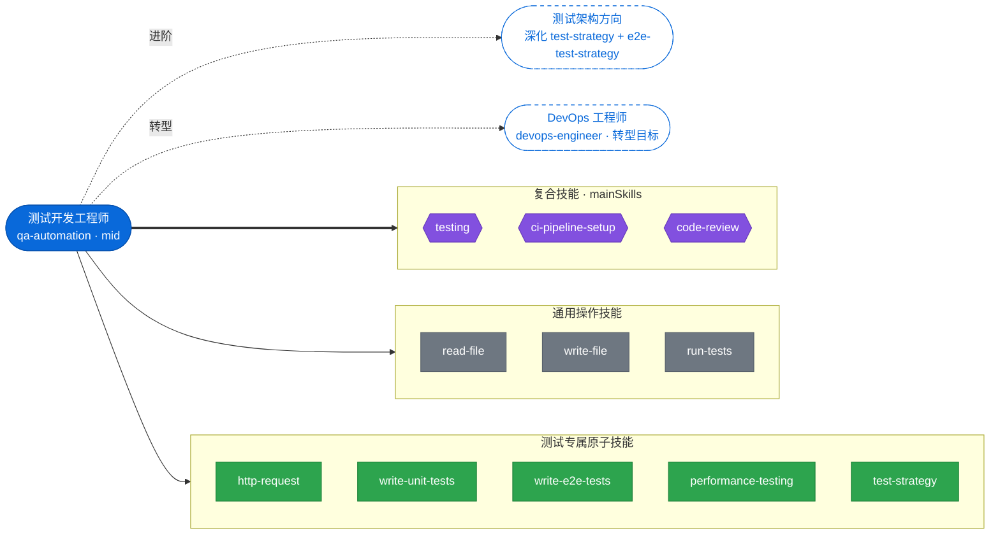

# roles

> 共 27 条。来源：internal。

| ID | 中文名 | 类型 | 来源 |
|----|--------|------|------|
| [security-engineer](./security-engineer.md) | 安全工程师 | role | internal |
| [product-manager](./product-manager.md) | 产品经理 | role | internal |
| [release-engineer](./release-engineer.md) | 发布工程师 | role | internal |
| [senior-frontend-dev](./senior-frontend-dev.md) | 高级前端开发工程师 | role | internal |
| [backend-architect](./backend-architect.md) | 后端架构师 | role | internal |
| [backend-developer](./backend-developer.md) | 后端开发工程师 | role | internal |
| [cto](./cto.md) | 技术负责人 | role | internal |
| [technical-writer](./technical-writer.md) | 技术文档工程师 | role | internal |
| [solution-architect](./solution-architect.md) | 解决方案架构师 | role | internal |
| [customer-success](./customer-success.md) | 客户成功经理 | role | internal |
| [platform-engineer](./platform-engineer.md) | 平台工程师 | role | internal |
| [frontend-developer](./frontend-developer.md) | 前端开发工程师 | role | internal |
| [fullstack-developer](./fullstack-developer.md) | 全栈工程师 | role | internal |
| [marketing-manager](./marketing-manager.md) | 市场经理 | role | internal |
| [data-analyst](./data-analyst.md) | 数据分析师 | role | internal |
| [data-engineer](./data-engineer.md) | 数据工程师 | role | internal |
| [data-scientist](./data-scientist.md) | 数据科学家 | role | internal |
| [engineering-manager](./engineering-manager.md) | 研发经理 / Tech Lead | role | internal |
| [mobile-developer](./mobile-developer.md) | 移动开发工程师 | role | internal |
| [cloud-security-engineer](./cloud-security-engineer.md) | 云安全工程师 | role | internal |
| [growth-engineer](./growth-engineer.md) | 增长工程师 | role | internal |
| [qa-automation](./qa-automation.md) | 自动化测试工程师 | role | internal |
| [ai-agent-engineer](./ai-agent-engineer.md) | AI Agent 工程师 | role | internal |
| [ai-ml-engineer](./ai-ml-engineer.md) | AI/LLM 工程师 | role | internal |
| [devops-engineer](./devops-engineer.md) | DevOps 工程师 | role | internal |
| [sre-engineer](./sre-engineer.md) | SRE 工程师 | role | internal |
| [ui-ux-designer](./ui-ux-designer.md) | UI/UX 设计师 | role | internal |

## 成长线索引

> 按职业发展路径组织的 role 导航。箭头表示典型晋升/转型方向，非唯一路径；横向转型（如后端 → 数据）通常从相邻线的 mid 级切入。

### 前端线

[frontend-developer](./frontend-developer.md)（mid）→ [senior-frontend-dev](./senior-frontend-dev.md)（senior）→ [engineering-manager](./engineering-manager.md) / [cto](./cto.md)

- 关键跃迁：mid → senior 靠 [frontend-performance-optimization](../frontend/frontend-performance-optimization.md) 与 [frontend-architecture](../frontend/frontend-architecture.md) 两条复合能力
- 相邻转型：[fullstack-developer](./fullstack-developer.md)（补后端）、[ui-ux-designer](./ui-ux-designer.md)（偏设计）

#### 前端岗位技能映射图

> 数据来源：两个 role 文件的 `mainSkills` / `atomicSkills` 字段（2026-11-25）。连线指向技能组：粗箭头 = 复合技能，细实线 = 原子技能，虚线 = 成长线方向。

- 组内技能即对应 role 的 frontmatter 所列技能；共享组中的技能同时出现在两个 role 的 `atomicSkills` 里。
- 关键跃迁对应的复合能力 `frontend-performance-optimization` / `frontend-architecture` 见上方文字说明，其中 `frontend-architecture` 同时是 mid 岗的 `mainSkills`。

### 后端线

[backend-developer](./backend-developer.md)（mid）→ [backend-architect](./backend-architect.md)（senior）→ [solution-architect](./solution-architect.md) / [cto](./cto.md)

- 关键跃迁：mid → senior 靠 [microservices-design](../backend/microservices-design.md)、[ddd-modeling](../backend/ddd-modeling.md)、[event-driven-architecture](../backend/event-driven-architecture.md)
- 相邻转型：[platform-engineer](./platform-engineer.md)（偏基础设施）、[data-engineer](./data-engineer.md)（偏数据管道）

#### 后端岗位技能映射图

> 数据来源：两个 role 文件的 `mainSkills` / `atomicSkills` 字段（2026-11-25）。连线指向技能组：粗箭头 = 复合技能，细实线 = 原子技能，虚线 = 成长线方向。

- 组内技能即对应 role 的 frontmatter 所列技能；共享组中的技能同时出现在两个 role 的 `atomicSkills` 里。
- 关键跃迁复合能力 `microservices-design` / `ddd-modeling` / `event-driven-architecture` 属后端域高级复合技能，见上方文字说明，未列入两岗 frontmatter。

### 数据线

[data-analyst](./data-analyst.md)（mid）→ [data-scientist](./data-scientist.md)（senior）→ [ai-ml-engineer](./ai-ml-engineer.md)

- 关键跃迁：analyst → scientist 靠 [statistical-modeling](../data/statistical-modeling.md)、[experiment-design](../data/experiment-design.md)、[causal-inference](../data/causal-inference.md)；scientist → ML engineer 靠 [ml-experiment-workflow](../data/ml-experiment-workflow.md) 的工程化能力
- 并行路径：[data-engineer](./data-engineer.md)（偏管道与平台，与 analyst/scientist 互为上下游）

#### 数据岗位技能映射图

> 数据来源：两个 role 文件的 `mainSkills` / `atomicSkills` 字段（2026-11-25）。连线指向技能组：粗箭头 = 复合技能，细实线 = 原子技能，虚线 = 成长线方向。

- 组内技能即对应 role 的 frontmatter 所列技能；共享组中的技能同时出现在两个 role 的 `atomicSkills` 里。
- 关键跃迁复合能力 `statistical-modeling` / `experiment-design` / `causal-inference` / `ml-experiment-workflow` 属数据域高级复合技能，见上方文字说明，未列入两岗 frontmatter；`ai-ml-engineer` 的技能组见「AI 岗位技能映射图」。

### AI 工程线

[ai-ml-engineer](./ai-ml-engineer.md)（senior）→ [ai-agent-engineer](./ai-agent-engineer.md)

- 关键跃迁：从模型训练到 agent 系统，核心补 [agent-orchestration](../ai-ml/agent-orchestration.md)、[agent-memory-design](../ai-ml/agent-memory-design.md)、[context-window-management](../ai-ml/context-window-management.md)、[guardrails-safety](../ai-ml/guardrails-safety.md)

#### AI 岗位技能映射图

> 数据来源：两个 role 文件的 `mainSkills` / `atomicSkills` 字段（2026-11-19）。连线指向技能组：粗箭头 = 复合技能（两岗共有），细实线 = 原子技能，虚线 = 成长线方向。

- 组内技能即对应 role 的 frontmatter 所列技能；共享组中的技能同时出现在两个 role 的 `atomicSkills` 里。
- 数据线入口 `data-analyst → data-scientist → ai-ml-engineer` 见上方成长线索引，本图聚焦 AI 两岗。

### DevOps / 平台线

[devops-engineer](./devops-engineer.md)（mid）→ [sre-engineer](./sre-engineer.md) / [platform-engineer](./platform-engineer.md) / [release-engineer](./release-engineer.md)（senior 分叉）

- 三个分叉的侧重：SRE 偏可靠性与 SLO、platform 偏内部开发者平台、release 偏交付流水线与 DORA 指标

#### DevOps 岗位技能映射图

> 数据来源：四个 role 文件的 `mainSkills` / `atomicSkills` 字段（2026-11-25）。连线指向技能组：粗箭头 = 复合技能，细实线 = 原子技能，虚线 = 成长线方向。DevOps 与 SRE 的 `mainSkills` 完全一致（8 项）。

```mermaid
flowchart LR
    DE(["DevOps 工程师<br/>devops-engineer · mid"])
    SRE(["SRE 工程师<br/>sre-engineer · senior"])
    PE(["平台工程师<br/>platform-engineer · senior"])
    RE(["发布工程师<br/>release-engineer · senior"])

    subgraph MAIN["复合技能 · mainSkills"]
        DCM{{"docker-container-management · DevOps+SRE"}}
        KDR{{"k8s-deployment-review · DevOps+SRE"}}
        TPR{{"terraform-plan-review · DevOps+SRE"}}
        CPS{{"ci-pipeline-setup · 四岗共有"}}
        MSS{{"monitoring-stack-setup · DevOps+SRE+PE"}}
        IDG{{"incident-diagnosis · DevOps+SRE"}}
        SAU{{"security-audit · DevOps+SRE"}}
        LOG{{"log-analysis · DevOps+SRE"}}
        RS{{"release-strategy · PE+RE"}}
        IA{{"infrastructure-automation · PE"}}
        CO{{"container-orchestration · PE"}}
    end

    subgraph OPS["通用操作技能 · DevOps/SRE/PE 共有"]
        RF["read-file"]
        WF["write-file"]
        RSC["run-shell-command"]
        DEX["docker-exec"]
        VKM["validate-k8s-manifest"]
        HHC["http-health-check"]
    end

    subgraph DESRE["可观测共享 · DevOps+SRE"]
        PJL["parse-json-log"]
        APIC["api-call"]
    end

    subgraph DELIVERY["交付链共享 · DevOps+PE/RE"]
        DKE["docker-essentials"]
        KB["kubernetes-basics"]
        GW["gitops-workflow"]
        CV["config-validator"]
        TB["terraform-basics"]
        GHA["github-actions"]
    end

    subgraph DEONLY["DevOps 专属"]
        DTK["docker-to-k8s"]
        ANS["ansible-automation"]
        SECM["secrets-management"]
        AWS["aws-cli-basics"]
        AZ["azure-cli-basics"]
        TCL["tencent-cloud-lighthouse"]
        CFM["cloudflare-manager"]
    end

    subgraph SREONLY["SRE 专属"]
        SREI["sre-engineer"]
        PM["prometheus-monitoring"]
        GDB["grafana-dashboard"]
        LO["logging-observability"]
        IRB["incident-runbook"]
        CO2["cost-optimization"]
        PHC["platform-healthcheck"]
        KS["k8s-security"]
        KT["k8s-troubleshooting"]
        SS["security-scan"]
        LP["log-parser"]
        SHC["service-health-check"]
        SWD["system-watchdog"]
    end

    subgraph PEONLY["平台工程师专属"]
        SM2["service-mesh"]
        DT["distributed-tracing"]
        SEB["slo-error-budget"]
    end

    subgraph REONLY["发布工程师专属"]
        IR2["incident-response"]
        MS["monitoring-setup"]
    end

    DE ==> MAIN
    SRE ==> MAIN
    PE ==> MAIN
    RE ==> MAIN
    DE --> OPS
    SRE --> OPS
    PE --> OPS
    DE --> DESRE
    SRE --> DESRE
    DE --> DELIVERY
    PE --> DELIVERY
    RE --> DELIVERY
    DE --> DEONLY
    SRE --> SREONLY
    PE --> PEONLY
    RE --> REONLY
    DE -.->|"成长线"| SRE
    DE -.->|"分叉"| PE
    DE -.->|"分叉"| RE

    classDef role fill:#0969da,stroke:#0550ae,color:#ffffff
    classDef composite fill:#8250df,stroke:#6639ba,color:#ffffff
    classDef atomic fill:#2da44e,stroke:#1a7f37,color:#ffffff
    classDef general fill:#6e7781,stroke:#57606a,color:#ffffff

    class DE,SRE,PE,RE role
    class DCM,KDR,TPR,CPS,MSS,IDG,SAU,LOG,RS,IA,CO composite
    class PJL,APIC,DKE,KB,GW,CV,TB,GHA,DTK,ANS,SECM,AWS,AZ,TCL,CFM,SREI,PM,GDB,LO,IRB,CO2,PHC,KS,KT,SS,LP,SHC,SWD,SM2,DT,SEB,IR2,MS atomic
    class RF,WF,RSC,DEX,VKM,HHC general
```

- 组内技能即对应 role 的 frontmatter 所列技能；`sre-engineer` 是 SRE 岗 `atomicSkills` 中的同名原子技能（按 frontmatter 忠实呈现）。
- 交付链共享组中的技能至少同时出现在 DevOps 与 PE/RE 之一的 `atomicSkills` 里。

### 安全线

[security-engineer](./security-engineer.md)（mid）→ [cloud-security-engineer](./cloud-security-engineer.md)（senior）

#### 安全岗位技能映射图

> 数据来源：两个 role 文件的 `mainSkills` / `atomicSkills` 字段（2026-11-25）。连线指向技能组：粗箭头 = 复合技能，细实线 = 原子技能，虚线 = 成长线方向。云安全岗 37 项原子技能按主题分子组呈现。

- 组内技能即对应 role 的 frontmatter 所列技能；云安全岗 `atomicSkills` 里的云原生操作 5 项（run-shell-command 等）与 DevOps 线共用同一批原子技能文件。

### 测试线

[qa-automation](./qa-automation.md)（mid）→ 测试架构方向（[e2e-test-strategy](../testing/e2e-test-strategy.md) + [test-strategy](../testing/test-strategy.md)）或转型 [devops-engineer](./devops-engineer.md)

#### 测试岗位技能映射图

> 数据来源：qa-automation 的 `mainSkills` / `atomicSkills` 字段（2026-11-25）。连线指向技能组：粗箭头 = 复合技能，细实线 = 原子技能，虚线 = 发展方向（空心节点为方向占位，非已建 role）。

- 组内技能即 role 的 frontmatter 所列技能；`test-strategy` 既是现有原子技能，也是测试架构方向的深化重点。
- 测试架构方向暂无独立 role 文件，对应复合技能 [e2e-test-strategy](../testing/e2e-test-strategy.md) 与 [test-strategy](../testing/test-strategy.md)。

### 管理与横向角色

- 技术管理：任意 senior 线 → [engineering-manager](./engineering-manager.md) → [cto](./cto.md)
- 产品/协作：[product-manager](./product-manager.md)、[technical-writer](./technical-writer.md)、[customer-success](./customer-success.md)、[marketing-manager](./marketing-manager.md)、[growth-engineer](./growth-engineer.md)

### 自评工具

- 用 [templates/gap-analysis.md](../../templates/gap-analysis.md) 做目标 role 的差距分析
- 用 `node tools/role-fit.js <role-id>` 做自评适配度打分（交互式 CLI）
